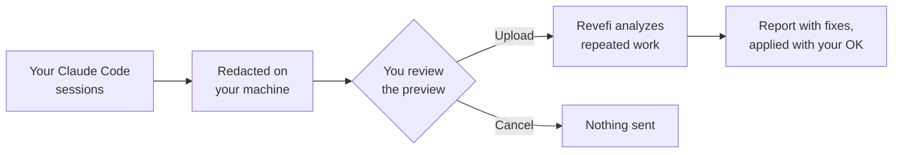

# Revefi Agent Analyzer

Find the work your coding agent keeps repeating, what it costs, and how to stop paying for it.

A Claude Code plugin that reads your recent sessions, redacts them on your machine, and, only
after you say yes, sends them to Revefi for analysis. You get a report of repeated tasks ranked
by spend, with a concrete fix for each: a skill, a script, a hook or a `CLAUDE.md` rule.



## Install

```text
/plugin marketplace add revefi/agent-analyzer
/plugin install revefi@revefi
```

Then run `/revefi:analyze` in any repository. It asks which sessions to scan (this directory,
this project, one you name, or all) and covers the last 14 days or your 100 latest sessions,
whichever is more, keeping the newest that fit in 200 MB compressed. The first time, it has you
sign in with Google or an emailed code. Needs Node.js 22.12 or newer, and Claude Code in a
terminal or an IDE.

## Redaction

Nothing leaves your machine until you approve. First you get a preview of the exact files that
would be sent, in `.revefi/upload-preview/`, with a report of everything removed:

- **Secrets:** API keys and tokens from major providers, private keys, JWTs, auth headers, and
  values under names like `password` or `token`
- **Personal data:** emails, phone numbers, card and bank numbers, national IDs and public IP
  addresses
- **Tool output:** file contents, command output and `.env` values; a failed call sends only its
  error lines
- **Images**, and your home folder path, which becomes `~`

Redaction matches known formats, so it can't catch everything. People's names and addresses
aren't detected. Read the preview, and ask Claude to leave out any session you'd rather not share.

Reports are private until you share them. Ask Claude to share one with specific people or with
anyone with the link, or to delete everything you've uploaded.

## Development

```bash
pnpm install && pnpm test && pnpm build
```

## Security and license

Report vulnerabilities as described in [SECURITY.md](SECURITY.md). Licensed under the
[Apache License 2.0](LICENSE).
